# VitalSense5 — Team Onboarding & Full-Stack Integration Guide

**VitalSense5** is a portable, real-time ICU-style physiological monitor built on a **Raspberry Pi 5 (2 GB)** with a **Waveshare 7-inch `1280x720` capacitive touchscreen** and an **ESP32-S3-Zero** edge acquisition MCU. It acquires dual-wavelength PPG (`MAX30102`) and battery telemetry (`INA219`) at `200 Hz`, streams Newline-Delimited JSON (NDJSON) over UART, runs signal processing and ML inference in Python (`SciPy` / `NumPy` / `PPGEdgePipeline`), and renders a `1280x720` `PyQt6` kiosk UI.

This guide gives every sub-team (**Firmware**, **Algorithms/ML**, **Backend/DB**, **Frontend/RPi 5**) the end-to-end context, integration contracts, local run/test commands, and active priorities needed to work together without breaking other layers.

---

## 1. Documentation Index (Where to Look)

| Document | Scope |
|---|---|
| [`project.md`](project.md) | System hardware BOM, communication overview, and output parameter list. |
| [`README.md`](README.md) | Frontend scope, Windows Python setup, and desktop/RPi5 launch commands. |
| [`firmware.md`](firmware.md) | Full ESP32-S3-Zero FreeRTOS spec, pinout, power-path diagram, I2C hot-plug logic, and NDJSON UART protocol. |
| [`src/vitalsense5/algorithms/algorithm_implementation.md`](src/vitalsense5/algorithms/algorithm_implementation.md) | `PPGEdgePipeline` architecture, 3-thread producer-consumer model, signal conditioning, and ML/math estimators (`RR`, `PRV`, `BP`). |
| [`docs/FRONTEND_PLAN.md`](docs/FRONTEND_PLAN.md) | `1280x720` PyQt6 screen/widget design, touchscreen ergonomics, and adapter integration boundaries. |
| [`docs/DESIGN_GAP_REPORT.md`](docs/DESIGN_GAP_REPORT.md) | Audit (`GAP-01`–`GAP-26`) comparing the Figma design against `project.md` and open product decisions. |

---

## 2. End-to-End System Architecture & Data Flow

```mermaid
flowchart LR
    subgraph Edge["Edge Hardware (ESP32-S3-Zero)"]
        Clip["MAX30102 Finger Clip (I2C1 0x57)"] -->|400 kHz| Core1["Core 1: TaskSensorAcquisition (200 Hz)"]
        Onboard["MAX30102 On-Board (I2C0 0x57)"] -->|400 kHz| Core1
        INA["INA219 Battery Monitor (I2C0 0x40)"] -->|1 Hz| Core1
        Core1 -->|FreeRTOS Queue| Core0["Core 0: TaskUartComms"]
    end

    subgraph RPi5["Raspberry Pi 5 (Python 3.10+)"]
        Core0 -->|"UART1 GPIO43/44 -> /dev/ttyAMA0 @ 460800 8N1 NDJSON"| Serial["SerialVitalAdapter (Thread 1: Reader)"]
        Serial -->|"r (AC-normalized)"| WaveQ["Waveform Queue"]
        Serial -->|"ir (12,000 samples / 60s)"| Ring["IR Ring Buffer"]
        Ring -->|"Every 5s (Worker Thread)"| Algo["PPGEdgePipeline (RR, PRV, BP)"]
        Algo -->|"VitalSnapshot"| Port["VitalDataPort"]
        WaveQ -->|"pop_waveform_samples @ 30 FPS"| UI["PyQt6 Kiosk UI (MainWindow)"]
        Port -->|"latest_vitals & device_status"| UI
        UI <-->|"PatientStorePort / SettingsPort / SessionCommandPort"| Stores["SQLite + Cloud Sync (Target)"]
    end
```



### Hardware Configuration Summary
- **Compute:** Raspberry Pi 5 (2 GB) running `PyQt6` + Python backend.
- **Display:** Waveshare 7-inch `1280x720` (H) capacitive touchscreen.
- **Edge MCU:** Waveshare `ESP32-S3-Zero` (`ESP32-S3FH4R2`, Dual-Core 240 MHz, 4 MB Flash, 2 MB Quad PSRAM).
- **Sensors:** Two `MAX30102` optical PPG sensors (Finger Clip on `I2C1` priority, On-Board on `I2C0` fallback; both `0x57`) + `INA219` high-side current/voltage monitor (`I2C0` `0x40`, `0.1 Ω` shunt).
- **Power:** `2S2P 18650` Li-Ion pack (`6.0 V` 0% – `8.4 V` 100%, `7000 mAh`), `TP5100` 2S charger, and `12 V` USB-C PD trigger.

---

## 3. Repository Layout

```text
VitalSense5/
├── TEAM_GUIDE.md                          # You are here: full-stack team context & integration guide
├── project.md                             # Hardware & system specification
├── README.md                              # Setup, run modes, and test commands
├── firmware.md                            # ESP32-S3 firmware & UART NDJSON protocol spec
├── pyproject.toml                         # Python package config, dependencies, pytest settings
├── requirements.txt                       # Python runtime & dev dependencies
├── assets/
│   ├── fonts/                             # Bundled JetBrainsMono-*.ttf (6 weights)
│   └── icons/                             # SVG icons (vs5_logo, cloud, battery, dropdown_arrow)
├── docs/
│   ├── FRONTEND_PLAN.md                   # UI architecture & contract boundaries
│   └── DESIGN_GAP_REPORT.md               # Design vs requirement gaps
├── firmware/                              # PlatformIO C++ FreeRTOS project (esp32-s3-zero)
│   ├── platformio.ini
│   ├── include/                           # config.h, protocol_types.h, sensor_manager.h, power_monitor.h, uart_comms.h
│   ├── src/                               # main.cpp, sensor_manager.cpp, power_monitor.cpp, uart_comms.cpp
│   └── test/                              # test_firmware_logic.cpp
├── src/vitalsense5/
│   ├── main.py                            # CLI (--windowed/--kiosk, --mock/--serial) & create_app()
│   ├── contracts/                         # Protocol ports (ports.py) & immutable DTOs (models.py)
│   ├── adapters/                          # MockVitalDataAdapter & InMemory* stores for PC dev/testing
│   ├── backend/                           # SerialVitalAdapter (UART1 NDJSON + PPGEdgePipeline)
│   ├── algorithms/                        # PPGEdgePipeline, RREstimator, PRVEstimator, BPEstimator
│   ├── screens/                           # MainWindow, MainScreen, PatientScreen, SettingsModal, NewPatientDialog
│   ├── widgets/                           # HeaderBar, VitalColumn, PPGCanvas, ActionButton, TouchScroll, VirtualKeyboard
│   └── theme/                             # Tokens, bundled font loader, QSS styles
└── tests/
    ├── unit/                              # Unit & integration tests (adapters, algorithms/serial, navigation, theme, widgets)
    └── e2e/                               # Tier 1–5 E2E tests & 1280x720 screenshot rubric
```

---

## 4. Sub-Team Ownership & Integration Contracts

All cross-layer integration in Python goes through **`src/vitalsense5/contracts/ports.py`** and **`src/vitalsense5/contracts/models.py`**, wired together in **`create_app(...)`** inside `src/vitalsense5/main.py`. **Do not edit UI widgets/screens to integrate backend or database logic** — implement the `Protocol` ports and inject them into `create_app(...)`.

### 4.1 Firmware Team (`firmware/`)
- **Platform:** PlatformIO (`espressif32`, `framework = arduino`), target `esp32-s3-devkitc-1` (`ESP32-S3FH4R2`).
- **Core Allocation:**
  - **Core 1 (`APP_CPU`):** `200 Hz` MAX30102 polling (`800 SPS` raw ADC with `SMP_AVE=4`), `500 ms` `I2C1` Finger Clip hot-plug probe (`0x57`), and `1 Hz` INA219 battery/SoC telemetry (`0x40`).
  - **Core 0 (`PRO_CPU`):** Drains FreeRTOS sample queue and streams NDJSON over **`UART1`** (`GPIO 43` TX, `GPIO 44` RX) at **`460800` baud `8N1`** to RPi 5 `/dev/ttyAMA0`. USB-C (`Serial`) is reserved for flashing and `115200` debug logs.
- **UART NDJSON Protocol:**
  - **Sample (`"type": "s"`, 200 Hz):** `{"type":"s","seq":...,"ts":...,"r":...,"ir":...,"src":"clip"|"onboard","f":1|0}`
  - **Telemetry (`"type": "t"`, 1 Hz):** `{"type":"t","up":...,"src":...,"clip":...,"ob":...,"f":...,"v":...,"i":...,"soc":...,"chg":...,"drp":...}`
  - **Commands (RPi 5 -> ESP32-S3):** `set_sensor_mode`, `set_led_current`, `set_ir_threshold`, `reset_sensor`, `get_status` (returns `"ack"` / `"err"`).
- **Deep Dive:** See [`firmware.md`](firmware.md).

### 4.2 Algorithms & ML Team (`src/vitalsense5/algorithms/`)
- **Entrypoint:** `PPGEdgePipeline(fs=200.0, use_pure_python=True)` in `src/vitalsense5/algorithms/core/edge_pipeline.py`.
- **Input:** `60 s` (`12,000` samples) of raw IR PPG at `200.0 Hz` + patient demographics dict (`{"age", "height", "weight", "gender"}` where `gender` is `1.0` Male / `0.0` Female, converted by `patient_record_to_demographics()` in `serial_vital_adapter.py`).
- **Outputs:**
  - `rr`: Respiratory Rate (`rr_bpm`) via `RREstimator`.
  - `prv`: Pulse Rate Variability (`rmssd`, `mean_ppi` -> BPM) via `PRVEstimator`.
  - `bp`: Systolic & Diastolic Blood Pressure (`sbp_mmHg`, `dbp_mmHg`) via `BPEstimator` (uses pure-Python tree models in `algorithms/blood_pressure/models/*.json` to avoid ARM C++ XGBoost build issues).
- **Important Gap:** `SerialVitalAdapter` currently leaves `spo2_percent` and `pi_percent` as `None` in `VitalSnapshot` (UI renders `--`). If SpO2 / PI estimators are added later, wire them into `SerialVitalAdapter` using the `"r"` and `"ir"` channels.
- **Deep Dive:** See [`src/vitalsense5/algorithms/algorithm_implementation.md`](src/vitalsense5/algorithms/algorithm_implementation.md).

### 4.3 Backend & Database Team (`src/vitalsense5/backend/` & `contracts/`)
- **Implemented:** `SerialVitalAdapter` (`src/vitalsense5/backend/serial_vital_adapter.py`) implements `VitalDataPort`, reading `460800` baud NDJSON, normalizing `"r"` for `PPGCanvasWidget`, feeding `"ir"` to `PPGEdgePipeline`, and mapping `"t"` packets to `DeviceStatus`.
- **Currently Mocked (In-Memory):** `src/vitalsense5/adapters/memory_stores.py` provides:
  - `InMemoryPatientStore` (`PatientStorePort`)
  - `InMemorySettingsStore` (`SettingsPort` — backs `SETTINGS 1`–`8` slots)
  - `MockSessionCommandHandler` (`SessionCommandPort` — `save_snapshot()` and `toggle_recording()`)
- **How to Plug In Production DB & Cloud:** Implement `PatientStorePort`, `SettingsPort`, and `SessionCommandPort` (e.g., backed by `SQLite` + background Cloud sync) and pass them to `create_app(...)` in `src/vitalsense5/main.py`:
  ```python
  window = create_app(
      patient_store=sqlite_patient_store,
      settings_store=sqlite_settings_store,
      command_handler=real_session_command_handler,
      kiosk=True,
      use_serial=True,
  )
  ```

### 4.4 Frontend & RPi 5 UI Team (`src/vitalsense5/screens/`, `widgets/`, `theme/`)
- **Fixed Resolution:** `1280x720` (`--windowed` on PC, `--kiosk` frameless fullscreen on RPi 5; `F11` toggles fullscreen).
- **UI Polling:** `MainWindow` polls `VitalDataPort` every `tick_ms` (`33 ms` default / ~30 FPS).
- **Touchscreen Ergonomics:** Custom `TouchScroll` (`>= 8 px` drag-vs-tap threshold) and in-app `VirtualKeyboard` (QWERTY + Numpad) so no external mouse/keyboard is needed in production.
- **Fonts & Assets:** Bundled `JetBrainsMono-*.ttf` and SVG icons in `assets/` are loaded at startup via `load_bundled_fonts()`.
- **Deep Dive:** See [`docs/FRONTEND_PLAN.md`](docs/FRONTEND_PLAN.md) and [`docs/DESIGN_GAP_REPORT.md`](docs/DESIGN_GAP_REPORT.md).

---

## 5. Active Team Priorities (What's Left to Build)

1. **SQLite Patient & Vitals Persistence:**
   - Replace `InMemoryPatientStore`, `InMemorySettingsStore`, and `MockSessionCommandHandler` with SQLite-backed implementations of `PatientStorePort`, `SettingsPort`, and `SessionCommandPort`.
   - Persist `SAVE` snapshots (`VitalSnapshot` + `PatientRecord`) and `RECORD` continuous sessions.
2. **Cloud DB Sync & Connectivity:**
   - Decide on the Cloud DB stack (currently `undecided` in `project.md`).
   - Implement background sync queue from SQLite and reflect real connectivity in `DeviceStatus.cloud_state` (`CloudState.ONLINE`, `OFFLINE`, `SYNCING`, `ERROR`).
3. **Raspberry Pi 5 OS, Kiosk & Hardware Deployment:**
   - Enable hardware UART (`/dev/ttyAMA0` on `GPIO 14/15`, disable serial console login in `raspi-config`/cmdline).
   - Verify Waveshare 7" `1280x720` touch mapping (`1:1` scaling) and Wayland/X11 auto-launch (`QT_QPA_PLATFORM=wayland python3 -m vitalsense5 --kiosk --serial`).
4. **Hardware-in-the-Loop (HIL) Testing & Calibration:**
   - Validate `SerialVitalAdapter` + `PPGEdgePipeline` end-to-end against live `ESP32-S3` + `MAX30102` data (including Finger Clip hot-plugging, `SensorState` transitions, and `INA219` battery SoC accuracy).
   - Calibrate/validate `RR`, `PRV`, and `BP` outputs on real subjects and confirm `5s` inference cadence performance on RPi 5 ARM Cortex-A76.

---

## 6. Quick-Start: Local Setup, Run & Test Commands

### Windows Python Warning
> Always use **`python`** (or `py -3.14`) — **never bare `py`**, which can launch free-threaded `python3.14t.exe` without `PyQt6`.

### Install & Run UI Locally (No Hardware Required)
```powershell
python -m pip install -r requirements.txt
$env:PYTHONPATH = "src"

# 1280x720 desktop window with simulated PPG & vitals:
python -m vitalsense5 --windowed --mock

# Fullscreen kiosk preview (press F11 to toggle):
python -m vitalsense5 --kiosk --mock

# Live UART serial mode (falls back to mock if port is missing):
python -m vitalsense5 --windowed --serial --serial-port COM3 --baudrate 460800
```

### Run Python Tests (Headless)
```powershell
$env:QT_QPA_PLATFORM = "offscreen"

# Unit tests:
python -m pytest tests/unit -v

# Full suite (unit + E2E + 1280x720 screenshot rubric):
python -m pytest
```

### Build & Flash ESP32-S3 Firmware (PlatformIO)
```powershell
cd firmware
pio run                  # Compile firmware
pio run -t upload        # Flash ESP32-S3-Zero over USB-C
pio device monitor       # 115200 baud USB CDC debug logs
```
