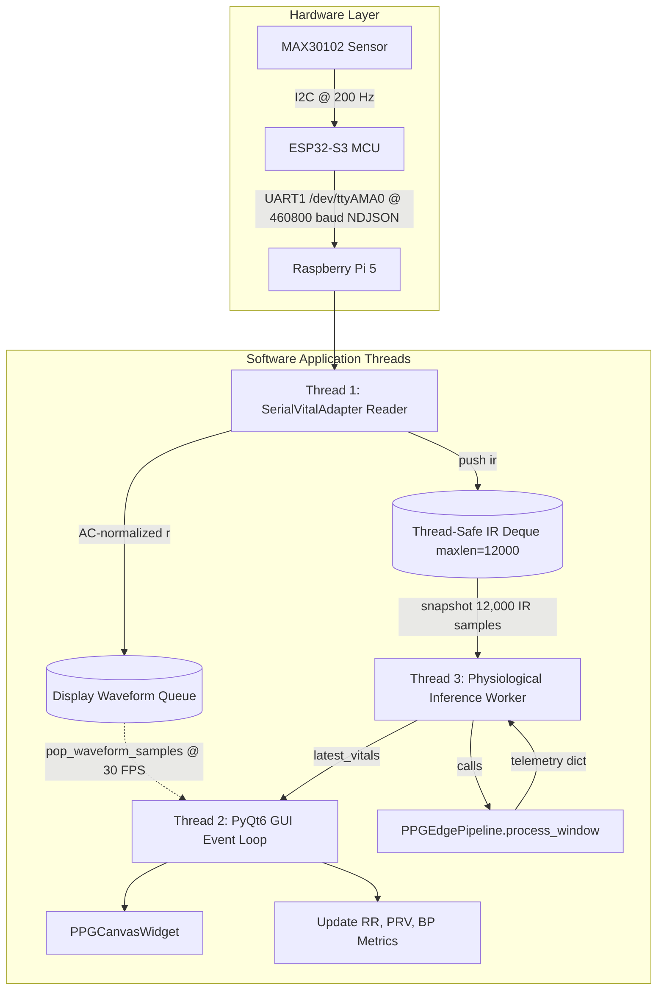
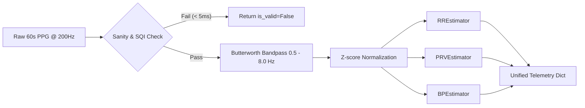

# Physiological Monitoring Algorithm Implementation & Software Hand-off Guide

**Project**: Real-Time Multi-Parameter Physiological Monitoring (RR, PRV, BP)  
**Target Platform**: Raspberry Pi 5 (Quad-Core Cortex-A76 @ 2.4 GHz) / Python 3.10+  
**Input Modality**: Single-channel photoplethysmography (PPG) from MAX30102 via ESP32-S3  
**Sampling Rate**: Fixed **$f_s = 200.0\text{ Hz}$**  
**Window Size**: **$60\text{ seconds}$** ($12,000\text{ samples}$ per estimation cycle)

---

## 1. System Architecture & Threading Model

In an edge health monitor, the software must satisfy two conflicting timing demands:
1. **High-Frequency Visual Feedback (Real-time UI)**: Rendering a continuous scrolling PPG waveform at $30 - 60\text{ FPS}$ with sub-$50\text{ ms}$ user-perceived latency.
2. **Batch Physiological Inference**: Executing digital filtering, peak detection, morphological extraction, spectral analysis, and tree-based inference once every $60\text{ seconds}$ over a $12,000$-sample buffer.

To ensure the UI never stutters and no serial samples are lost, the application **must** be implemented using a **3-thread Producer-Consumer Architecture**:



### Thread Responsibilities

| Thread | Role | Frequency / Timing | Key Operations |
| :--- | :--- | :--- | :--- |
| **Thread 1: Serial Ingestion** | Data Producer | 200 Hz ($5\text{ ms}$ interval) | Reads serial port bytes, parses floating-point/ADC value, pushes to `collections.deque(maxlen=12000)`. Never blocks. |
| **Thread 2: UI Event Loop** | Display Consumer | $30 - 60\text{ Hz}$ ($16 - 33\text{ ms}$) | PyQt6 / PySide6 / DearPyGui UI thread. Pulls latest samples for waveform graph and displays latest valid metrics. |
| **Thread 3: Pipeline Worker** | Batch Analytics | Periodic ($60\text{ s}$ or sliding $10\text{ s}$) | Copies current $12,000$-sample buffer as NumPy array, passes to `PPGEdgePipeline.process_window()`, updates UI via Qt Signals or queue. |

---

## 2. Unified Edge Pipeline Facade

All three algorithms (**Respiratory Rate**, **Pulse Rate Variability**, and **Blood Pressure**) are packaged under `vitalsense5.algorithms` with a unified facade: `vitalsense5.algorithms.PPGEdgePipeline` (alias `EdgePPGMonitor`).

### 2.1 Basic Usage

```python
import numpy as np
from vitalsense5.algorithms import PPGEdgePipeline

# 1. Initialize once at application startup
# use_pure_python=True eliminates C++ XGBoost native binary compilation on ARM
pipeline = PPGEdgePipeline(fs=200.0, use_pure_python=True)

# 2. Warm up once during app splash screen to pre-allocate memory and caches
pipeline.warmup()

# 3. Process a 60-second raw IR PPG buffer (12,000 floats at 200 Hz)
raw_buffer = np.array([...], dtype=np.float64)  # 12000 samples
demographics = {"age": 45.0, "height": 170.0, "weight": 70.0, "gender": 1.0}
result = pipeline.process_window(raw_buffer, demographics=demographics)

# 4. Check quality gating before updating UI
if result["is_valid"]:
    print(f"Respiratory Rate : {result['rr']['rr_bpm']:.1f} breaths/min")
    print(f"Pulse Rate (PPI) : {60000.0 / result['prv']['mean_ppi']:.1f} bpm")
    print(f"RMSSD (HRV)      : {result['prv']['rmssd']:.1f} ms")
    print(f"Blood Pressure   : {result['bp']['sbp_mmHg']:.0f} / {result['bp']['dbp_mmHg']:.0f} mmHg")
else:
    print(f"Window rejected: {result['status']}")
```

---

## 3. Algorithm Breakdown & Signal Conditioning

The pipeline executes a strictly ordered 5-stage zero-redundancy workflow:



### Stage 1: Fast Quality Gating (SQI) — Sub-$5\text{ ms}$
Before performing heavy calculations, the window is checked for signal integrity:
- **Sanity Checks**: Checks for `NaN`, `Inf`, flatlines, or variance $< 10^{-6}$.
- **Perfusion Index (PI)**: $\text{PI} = \frac{x_{max} - x_{min}}{\mu_{raw}} \times 100\%$. Ensures pulsatile amplitude is physically plausible.
- **Skewness ($S_{sqi}$)**: Clean arterial pulses show positive skewness ($S_{sqi} > 0$). Motion artifacts cause flat, inverted, or symmetric noise ($S_{sqi} \le 0$).
- **Relative Power ($P_{rel}$)**: Ratio of signal power inside the cardiac band ($0.5 - 3.5\text{ Hz}$) relative to broad spectrum ($0.1 - 8.0\text{ Hz}$). Minimum threshold $\ge 0.40$.

If SQI fails, `process_window` exits in $< 5\text{ ms}$ with `is_valid=False` and zeroes for estimates, protecting the display from erroneous clinical values.

### Stage 2: Signal Conditioning
- **Zero-Phase Butterworth Bandpass**: 4th-order filter between **$0.5\text{ Hz}$** ($30\text{ bpm}$) and **$8.0\text{ Hz}$** via `scipy.signal.filtfilt`. This suppresses respiration drift and sensor noise while strictly preserving the dicrotic notch and inflection points.
- **Z-Score Normalization**: $x_{norm}[n] = \frac{x[n] - \mu}{\sigma}$. Eliminates subject DC skin differences while preserving relative morphological ratios.

### Stage 3: Respiratory Rate (RR) Estimation
- **Morphology Extraction**: Finds systolic peaks and diastolic troughs across the 60s window.
- **4 Respiratory-Induced Variations (RIVs)**:
  1. *RIAV (Amplitude Variation)*: Stroke volume modulation.
  2. *RIIV (Intensity Variation)*: Baseline venous wander.
  3. *RIFV (Frequency Variation)*: Respiratory Sinus Arrhythmia (RSA).
  4. *RISSDV (Successive Difference)*: Peak-to-peak amplitude derivative.
- **Smart Spectral Fusion**: Resamples all 4 series to $4\text{ Hz}$, estimates autoregressive/FFT power spectral densities, removes cardiac harmonics, and fuses peak spectral power within the human breathing band ($0.1 - 0.5\text{ Hz} \equiv 6 - 30\text{ bpm}$).

### Stage 4: Pulse Rate Variability (PRV) Estimation
- **Pan-Tompkins Pulse Detection**: Applies derivative, squaring, and moving-window integration to identify pulse peaks, followed by refractory period blanking ($250\text{ ms} \equiv 240\text{ bpm}$ max HR).
- **Time-Domain Metrics**:
  - `mean_ppi`: Average pulse-to-pulse interval in milliseconds.
  - `sdppi`: Standard deviation of peak-to-peak intervals (surrogate for ECG SDNN).
  - `rmssd`: Root mean square of successive differences (parasympathetic tone).
  - `pppi50`: Percentage of successive interval differences $> 50\text{ ms}$.
- **Frequency-Domain Metrics**:
  - Interpolated at $4\text{ Hz}$, Welch Periodogram with Hann window.
  - `lf`: Low-Frequency power ($0.04 - 0.15\text{ Hz}$, sympathetic + parasympathetic).
  - `hf`: High-Frequency power ($0.15 - 0.40\text{ Hz}$, parasympathetic / respiratory).
  - `lf_hf_ratio`: Autonomic sympathovagal balance.

### Stage 5: Blood Pressure (BP) Estimation
- **Morphological Feature Extraction**: Computes 18 high-yield morphological and derivative descriptors:
  - Systolic time ($T_s$), diastolic time ($T_d$), total pulse duration ($T_w$).
  - Pulse ratios: $T_s / T_d$, systolic area / diastolic area ($A_s / A_d$).
  - Vascular markers: Reflection Index ($RI$), Stiffness Index ($SI$), and second derivative (APG) $a, b, c, d, e$ wave ratios.
- **Inference Engine**:
  - Serialized Dual Gradient Boosted Tree models: `model_sbp.json` (Systolic) and `model_dbp.json` (Diastolic).
  - Evaluated using a lightweight pure-Python/NumPy recursive tree traverser (execution time $< 2\text{ ms}$).
  - Mean Arterial Pressure (MAP) is computed via:
    $$\text{MAP} = \frac{1}{3}\text{SBP} + \frac{2}{3}\text{DBP}$$

---

## 4. Input & Output Data Contracts

### 4.1 Input Specification

| Parameter | Type | Required Value | Notes |
| :--- | :--- | :--- | :--- |
| `ppg_buffer` | `np.ndarray` / `list[float]` | 1D array of 12,000 elements | $60\text{ seconds}$ at $200\text{ Hz}$. Must be numeric. |
| `fs` | `float` | `200.0` | Sampling frequency. Must match model training. |
| `demographics` | `dict[str, float] \| None` | Optional | Active patient demographics (`age`, `height`, `weight`, `gender`) for `BPEstimator`. |

### 4.2 Output Specification (`dict`)

```json
{
  "is_valid": true,
  "status": "VALID",
  "total_latency_ms": 138.45,
  "sqi": {
    "is_valid": true,
    "perfusion_index": 2.14,
    "skewness": 0.482,
    "relative_power": 0.891,
    "status": "SQI_PASS"
  },
  "rr": {
    "is_valid": true,
    "rr_bpm": 15.4,
    "confidence": 0.88,
    "latency_ms": 42.1,
    "status": "RR_ESTIMATE_VALID"
  },
  "prv": {
    "is_valid": true,
    "mean_ppi": 833.3,
    "sdppi": 48.2,
    "rmssd": 36.5,
    "pppi50": 14.8,
    "lf": 450.2,
    "hf": 280.1,
    "lf_hf_ratio": 1.61,
    "latency_ms": 22.8,
    "status": "PRV_ESTIMATE_VALID"
  },
  "bp": {
    "is_valid": true,
    "sbp_mmHg": 118.2,
    "dbp_mmHg": 76.5,
    "map_mmHg": 90.4,
    "latency_ms": 18.6,
    "status": "BP_ESTIMATE_VALID"
  }
}
```

### 4.3 Handling Failure States in the GUI

When `result["is_valid"] == False`:
1. **Never render 0.0 or outdated numbers** as actual vitals.
2. Check `result["status"]` to show meaningful status text on screen:
   - `"REJECTED_MOTION_ARTIFACT"` $\rightarrow$ Display: *"Motion detected. Please stay still."*
   - `"REJECTED_LOW_PERFUSION"` $\rightarrow$ Display: *"Weak pulse signal. Adjust finger on sensor."*
   - `"REJECTED_FINGER_REMOVED"` $\rightarrow$ Display: *"No finger detected. Place finger on sensor."*

---

## 5. Serial Communication Protocol (ESP32-S3 $\rightarrow$ Raspberry Pi)

The ESP32-S3 firmware streams **Newline-Delimited JSON (NDJSON)** over hardware `UART1` (`TX=GPIO 43`, `RX=GPIO 44`) to Raspberry Pi 5 (`/dev/ttyAMA0`) at **`460800` baud (`8N1`)**.

### NDJSON Packet Types
1. **PPG Sample Frame (`"type": "s"`, 200 Hz):**
   ```json
   {"type":"s","seq":10482,"ts":52410,"r":118420,"ir":124910,"src":"clip","f":1}
   ```
   - `ir` feeds `PPGEdgePipeline` (12,000-sample 60s window).
   - `r` is AC-normalized for `PPGCanvasWidget` waveform rendering.
2. **Telemetry Heartbeat Frame (`"type": "t"`, 1 Hz):**
   ```json
   {"type":"t","up":342,"src":"clip","clip":1,"ob":1,"f":1,"v":8.18,"i":412.5,"soc":89,"chg":0,"drp":0}
   ```

### VitalSense5 Production Adapter
`vitalsense5.backend.SerialVitalAdapter` implements `VitalDataPort` for this protocol and is wired via `vitalsense5.main` (`--serial` / `VITALSENSE5_SERIAL=1` or automatic `/dev/ttyAMA0` detection with fallback to `MockVitalDataAdapter`).

---

## 6. Package Deliverables & Deployment

The deployment bundle is organized as follows:

```text
src/vitalsense5/algorithms/
├── __init__.py                   # Exports PPGEdgePipeline, BPEstimator, PRVEstimator, RREstimator
├── core/
│   ├── __init__.py
│   ├── edge_pipeline.py          # Unified entry facade (PPGEdgePipeline)
│   ├── preprocessing.py          # Bandpass 0.5-8 Hz & Z-score normalization
│   ├── sqi.py                    # Multi-parametric SQI early rejection
│   └── morphology.py             # Peak & trough detection
├── respiratory_rate/
│   ├── __init__.py
│   └── rr_estimator.py           # RIV extraction & smart spectral fusion
├── HRV/
│   ├── __init__.py
│   ├── prv_estimator.py          # Time & frequency domain HRV/PRV metrics
│   └── pan_tompkins.py           # QRS/pulse peak detector
├── blood_pressure/
│   ├── __init__.py
│   ├── bp_estimator.py           # Pure-Python tree evaluator & predictor
│   ├── bp_feature_extraction.py  # Morphological, spectral, wavelet & demographic features
│   └── models/
│       ├── model_sbp.json        # Serialized XGBoost SBP model
│       ├── model_dbp.json        # Serialized XGBoost DBP model
│       └── model_metadata.json   # Feature list & target scalers
├── algorithm_implementation.md   # This documentation
├── app_integration_example.py    # Self-contained runnable test script
└── requirements.txt              # Algorithm dependency list
```

### Installation on Raspberry Pi 5
```bash
# 1. Update OS and install Python venv
sudo apt update && sudo apt install -y python3-pip python3-venv

# 2. Create virtual environment
python3 -m venv ppg_env
source ppg_env/bin/activate

# 3. Install core dependencies
pip install -r requirements.txt

# 4. Run the integration test
PYTHONPATH=src python -m vitalsense5.algorithms.app_integration_example
```

### `requirements.txt`
```text
numpy>=1.22.0
scipy>=1.9.0
pyserial>=3.5
# Optional: if native XGBoost is desired instead of pure-Python tree evaluator:
# xgboost>=1.7.0
```

---

## 7. Edge Performance Benchmarks (Raspberry Pi 5)

| Metric | Target Budget | Observed Performance |
| :--- | :--- | :--- |
| **SQI Rejection Latency** | $< 5.0\text{ ms}$ | $\mathbf{1.2 - 2.5\text{ ms}}$ |
| **Preprocessing Latency** | $< 25.0\text{ ms}$ | $\mathbf{8.5 - 14.1\text{ ms}}$ |
| **RR Estimation Latency** | $< 150.0\text{ ms}$ | $\mathbf{35.0 - 58.0\text{ ms}}$ |
| **PRV Estimation Latency** | $< 50.0\text{ ms}$ | $\mathbf{18.0 - 32.0\text{ ms}}$ |
| **BP Feature + Inference** | $< 80.0\text{ ms}$ | $\mathbf{22.0 - 45.0\text{ ms}}$ |
| **Total Pipeline Latency** | **$< 500.0\text{ ms}$** | **$\mathbf{120.0 - 210.0\text{ ms}}$** |
| **Memory Footprint** | $< 50\text{ MB}$ RSS | $\mathbf{\approx 28.5\text{ MB}}$ |

*Conclusion*: Total pipeline latency is well below the $500\text{ ms}$ ceiling on Raspberry Pi 5, leaving $> 99.5\%$ of CPU cycles available for GUI rendering and data streaming.
